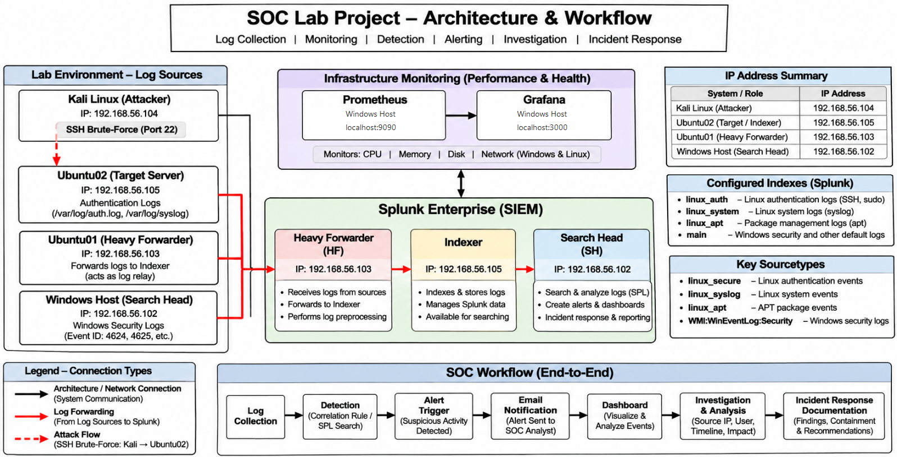

# SOC Homelab & Splunk SIEM Log Analysis

A practical distributed Security Operations Center (SOC) homelab implementing centralized log collection, Splunk SIEM security event analysis, controlled threat simulation, scheduled alerting, and infrastructure monitoring.

---

## Project Overview

This project demonstrates the design, deployment, and practical operation of a distributed SOC environment across isolated virtual systems. Telemetry from Linux and Windows endpoints is centrally collected and forwarded through a distributed Splunk architecture (Heavy Forwarder, Indexer, Search Head) for real-time security monitoring, detection engineering, and incident investigation.

---

## Architecture

---

## What I Built

- **Distributed Splunk Architecture**: Deployed dedicated instances for Heavy Forwarder (Ubuntu01), Indexer (Ubuntu02), and Search Head (Windows Host).
- **Centralized Linux Log Collection & Forwarding**: Configured multi-tier log transport using rsyslog (TCP 5514) and Splunk forwarding (TCP 9997) into dedicated custom indexes.
- **Controlled SSH Brute-Force Simulation**: Simulated automated credential attacks from Kali Linux against the target server using THC-Hydra.
- **SPL-Based Event Analysis & Investigation**: Engineered Search Processing Language (SPL) queries for regex field extraction, event aggregation, and threat triage.
- **SOC Monitoring Dashboard**: Built the *SOC Lab - SSH Brute-Force Attack Monitoring* dashboard for real-time visualization of failed login volumes, attack trends over time, and attacking source IPs.
- **Scheduled Alerts & Email Notifications**: Configured an automated cron-scheduled alert with throttling suppression and verified email notification delivery to the analyst inbox.
- **Prometheus & Grafana Infrastructure Monitoring**: Monitored hardware and system resource metrics (CPU, memory, disk, network) across the lab environment.

---

## Investigation Results

Following alert detection, a structured security incident investigation was performed in Splunk Enterprise:

- **Failed Attempts**: **25 failed SSH password events** identified during the simulation cycles.
- **Attack Source**: Kali Linux (`192.168.56.104`).
- **Target System**: Ubuntu02 (`192.168.56.105`).
- **Target Account**: `soc_test`.
- **Compromise Status**: **No matching successful SSH authentication event identified** in the selected 24-hour investigation period.
- **Final Verdict**: Confirmed controlled SSH brute-force attack simulation — no matching successful SSH authentication event identified during the selected 24-hour investigation period.

---

## Documentation

Comprehensive step-by-step guides, configuration files, and implementation details are available in the repository documentation:

- **[Document 1 – SOC Lab Implementation & Investigation Guide](https://github.com/Hari2343004/SOC-Homelab-Splunk-SIEM/blob/main/Documentation/SOC-Lab-Implementation.pdf)**: Complete documentation covering the controlled attack simulation, authentication log verification, SPL search queries, dashboard creation, scheduled alert setup, and incident response findings.
- **[Document 2 – Splunk Installation & Configuration Guide](https://github.com/Hari2343004/SOC-Homelab-Splunk-SIEM/blob/main/Documentation/Splunk-Configuration.pdf)**: Complete documentation covering Oracle VirtualBox networking, multi-instance Splunk deployment, Heavy Forwarder inputs/outputs configuration, custom index creation, and distributed search verification.

---

## Video Walkthrough

A practical video walkthrough demonstrating the entire project lifecycle—from attack simulation and real-time SIEM log processing to alert dispatch, triage, and infrastructure metrics—is available here:

- **[SOC Homelab Project Walkthrough Video (Google Drive)](https://drive.google.com/file/d/1skZ_Gaz0cTB10CHIhB519Be2ywq2TXpl/view?usp=sharing)**
